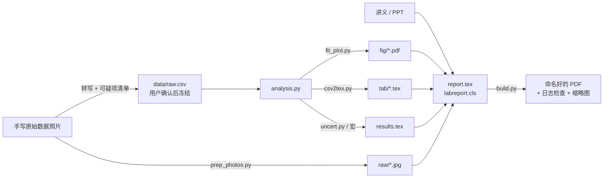

# 技术说明

> 一般用户不需要看这页——直接把首页那句话发给你的 AI，让它安装和操作就行。这里是给想了解原理、手动安装或参与开发的人看的。

## 功能

| | |
|---|---|
| 📄 **文档类 `labreport.cls`** | XeLaTeX + ctex；带框章节（像学校 Word 模板的大表格）或普通样式；封面样式可扩展；教师评阅栏、评分表、原始数据照片页一条命令生成 |
| 🔢 **数字可追溯** | `fit_plot.py` / `uncert.py` 把结果写成 LaTeX 宏，正文写 `\num{\RichK}`，改了原始数据重跑即可，杜绝手抄错误 |
| 📈 **拟合作图** | 直线 / 过原点 / 多项式拟合，特性曲线、回线（按记录顺序连）、对数轴、找峰谷、多组、外延到 0；能直接读光谱仪等导出的 TXT；输出矢量 PDF |
| 📏 **不确定度与修约** | A/B 类合成、逐差法；不确定度“只进不舍”、测量值“四舍六入五凑偶” |
| 📋 **CSV → 表格** | 单元格原样输出，`0.40` 不会变成 `0.4`；自动处理下标、负号、√ |
| 🔍 **编译即检查** | `build.py` 编译后列出错误、**缺字**、未定义引用、超宽行，按老师规则命名，生成逐页缩略图和总览图供 Agent 目检 |
| 📷 **照片处理** | 手机照片按 EXIF 转正、压缩，原样放进 PDF（不裁剪、不修图） |
| 📑 **要求驱动** | 从模板和讲义抽出需求清单（章节顺序、评分项、点名要做的图表）；`build.py --require` 编译时核对缺失/顺序、遗留占位符、封面空字段 |
| 🧪 **五类实验打法** | 测定一个量 / 特性曲线 / 分布 / 仪器导出数据 / 观察定性，各自的“数据处理”和“结果陈述”写法——从 25 份真实报告总结而来（[report-patterns.md](../skills/lab-report-tex/references/report-patterns.md)） |
| 🗂️ **自动识别材料** | 一堆文件直接扔进来：`inventory.py` 粗分 + AI 逐个打开确认（照片看图），分清模板 / 要求 / 讲义 / 原始记录 / 仪器数据 / 预习试卷 / 参考报告，列《材料清单》给你确认（[intake.md](../skills/lab-report-tex/references/intake.md)） |
| 🧭 **流程规范** | 数据转写 → 可疑项清单 → 用户确认 → 冻结；不编造数据、签名、日期 |

## 工作原理



**关键设计：数据 → 脚本 → 宏 → 正文。** 模型负责写文字和组织结构，数字全部由脚本算出并以宏的形式进入 LaTeX。这样既用上了大模型的写作能力，又避开了它最不可靠的地方——抄数字和心算。

## 快速开始

```bash
git clone https://github.com/ZhuZiheng66/lab-report-tex.git
cd lab-report-tex
python install.py                                   # 装到本机已有的 ~/.claude、~/.codex、~/.agents
python skills/lab-report-tex/scripts/check_env.py   # 检查 XeLaTeX、Python 依赖、中文字体
```

然后在课程文件夹里对 Agent 说：

> 帮我做这次的大物实验报告，讲义是 `光拍法测光速.pptx`，原始数据照片在 `raw/` 里。

Agent 会按 [SKILL.md](../skills/lab-report-tex/SKILL.md) 的流程：读讲义 → 转写数据并请你核对 → 计算作图 → 写 report.tex → 编译检查 → 交付 PDF。

**跑一遍示例：**

```bash
cd examples/work-function
python analysis.py
python ../../skills/lab-report-tex/scripts/build.py report.tex --thumbs preview
```

依赖：Python 3.7+（numpy、matplotlib、pillow，可选 pymupdf），XeLaTeX（[MiKTeX](https://miktex.org/) / [TeX Live](https://tug.org/texlive/) / [Tectonic](https://tectonic-typesetting.github.io/)）。没有本地 LaTeX 也可以把工作目录上传 [Overleaf](https://www.overleaf.com/) 用 XeLaTeX 编译。

## 兼容的 Agent

Skill 遵循开放的 Agent Skills 格式（文件夹 + 带 YAML 头的 `SKILL.md`），脚本是纯 Python，不依赖任何特定平台的 API。

| 工具 | 用法 |
|---|---|
| Claude Code | `python install.py --target claude`，说“做实验报告”自动触发 |
| Codex CLI | `python install.py --target codex`，或使用仓库根目录的 [AGENTS.md](../AGENTS.md) |
| 豆包工作 | 技能 → 上传技能 → 选择文件夹 `skills/lab-report-tex`，或 `python install.py --target doubao` |
| WorkBuddy | `python install.py --target workbuddy` |
| DeepSeek Harness | `python install.py --target dsh` |
| 扣子等其他平台 | `python install.py --zip`，上传 `dist/` 里的 zip |
| Cursor / Trae / Windsurf | 把 `skills/lab-report-tex` 放进项目，规则里指向 SKILL.md |

详见 [platforms.md](../skills/lab-report-tex/references/platforms.md)。

## 仓库结构

```
skills/lab-report-tex/
  SKILL.md                 Agent 入口：流程与原则
  references/              按需加载的细节：数据核对、不确定度、LaTeX 用法、写作规范、踩坑记录、课程配置模板
  scripts/                 inventory.py（识别材料） read_template.py（解析模板，含嵌套表） convert_legacy.py（.doc/.ppt 转换）
                           data_status.py（数据确认状态）  provenance.py（可追溯元数据 results.meta.json）
                           build.py  fit_plot.py  uncert.py  csv2tex.py  prep_photos.py  check_env.py  texmacros.py
  templates/               labreport.cls  report.tex  analysis.py
examples/                  两个完整示例（真实数据，个人信息已替换）
tests/run_examples.py      回归测试：把示例复制到临时目录重跑并验收（不改动仓库文件）
tests/test_*.py            单元测试：python -m unittest discover -s tests -v
requirements.txt           Python 依赖与最低版本
install.py                 一键安装 / 打包
AGENTS.md                  给 Codex 等 Agent 的说明
```

## 适配你的学校

1. 复制 [profile-template.md](../skills/lab-report-tex/references/profile-template.md) 为课程文件夹下的 `lab-profile.md`，填个人信息、命名规则、页序、评分栏（这个文件已被 .gitignore 忽略）。
2. 封面：`cover=simple` 通用；要还原学校模板，在 `labreport.cls` 里仿照 `\lab@cover@szu` 加一个样式。欢迎 PR 你学校的封面！

## Roadmap

- [ ] 更多学校封面样式
- [ ] 电路 / 化学 / 材料类实验示例
- [ ] 讲义 PPT 自动抽取目的、原理、思考题
- [ ] 可选 Word 导出（给要求交 .docx 的课程）

## English

**lab-report-tex** is a cross-agent skill (Claude Code, Codex, Cursor, WorkBuddy, DeepSeek Harness …) that turns lab handouts and handwritten raw-data photos into a well-typeset Chinese lab report via XeLaTeX. Its core idea is *data → scripts → LaTeX macros → text*: the model writes prose, while every number in the report is computed by scripts (least-squares fitting, uncertainty propagation, rounding rules) and injected as macros, so nothing is hand-copied and everything is reproducible. `build.py` compiles, lints the log (missing glyphs, undefined refs, overfull boxes), names the PDF by the teacher's rule and renders thumbnails for visual QA.
